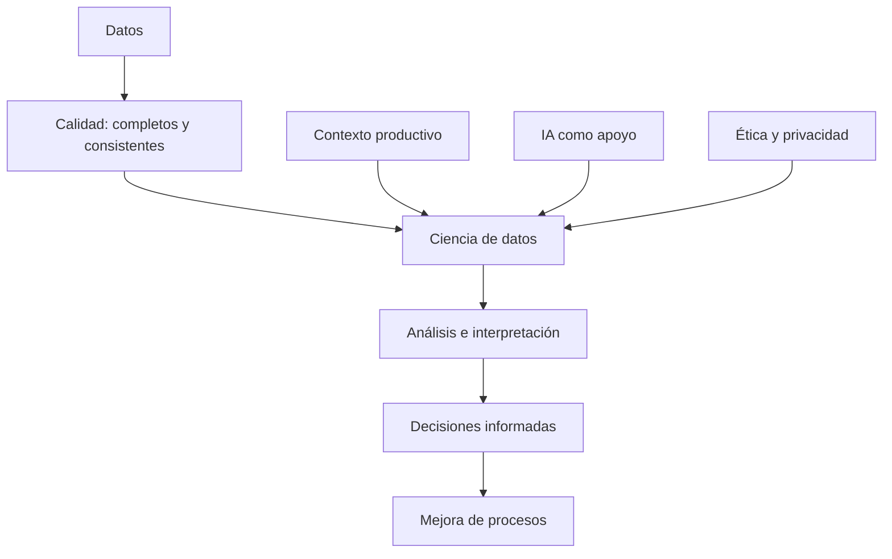

# Actividad 3.3 — Contexto actual de la ciencia de datos

## Síntesis
La ciencia de datos es importante para el desarrollo de software porque ayuda a entender problemas mediante evidencias y no solo suposiciones. Combina programación, análisis, conocimiento del contexto y comunicación. En un sistema de reservas o de inventario, por ejemplo, se pueden identificar horarios con mayor demanda y recursos que están por agotarse. La inteligencia artificial puede ayudar a organizar o interpretar datos, pero debemos revisar sus resultados, cuidar la privacidad y evitar decisiones injustas. También es importante comprobar la calidad de los datos antes de sacar conclusiones.

## Mapa conceptual (vista previa Mermaid en VS Code compatible)

**Conceptos incluidos:** datos, calidad, ciencia de datos, contexto productivo, IA, ética y decisión. Si VS Code no muestra el diagrama, abre este archivo en una extensión compatible con Mermaid o visualiza `docs/diagramas.html` en el navegador.
