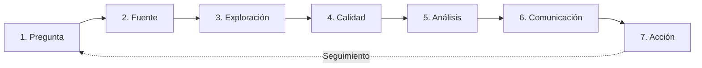

# Actividad 3.4 — Ciclo de vida del dato

**Caso aplicado:** reconocer necesidades de acompañamiento académico en una ficha SENA sin señalar ni etiquetar a los aprendices.

| Fase | Aplicación al caso |
|---|---|
| Pregunta | ¿Qué aprendices podrían requerir acompañamiento preventivo? |
| Fuente | Registro autorizado de asistencias, notas y entregas. |
| Exploración | Revisar columnas, cantidad de registros y tipos. |
| Calidad | Buscar valores vacíos, porcentajes inválidos y registros repetidos. |
| Análisis | Contar asistencias bajas y analizar promedios sin sacar conclusiones apresuradas. |
| Comunicación | Elaborar informe claro para personal autorizado. |
| Acción | Conversar con aprendices y ofrecer apoyo según el contexto. |

> La secuencia es orientativa; los hallazgos deben verificarse antes de cualquier decisión. También puedes ver el diagrama en `docs/diagramas.html`.
